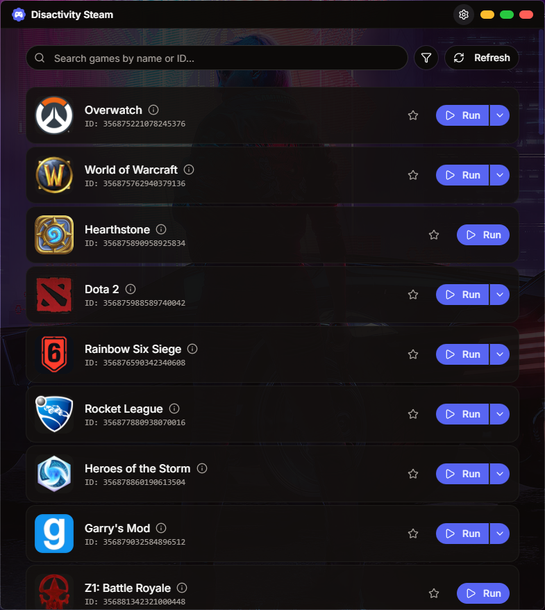
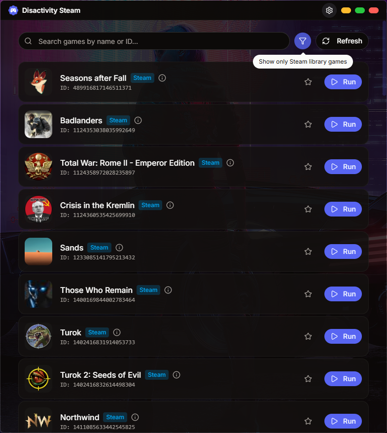
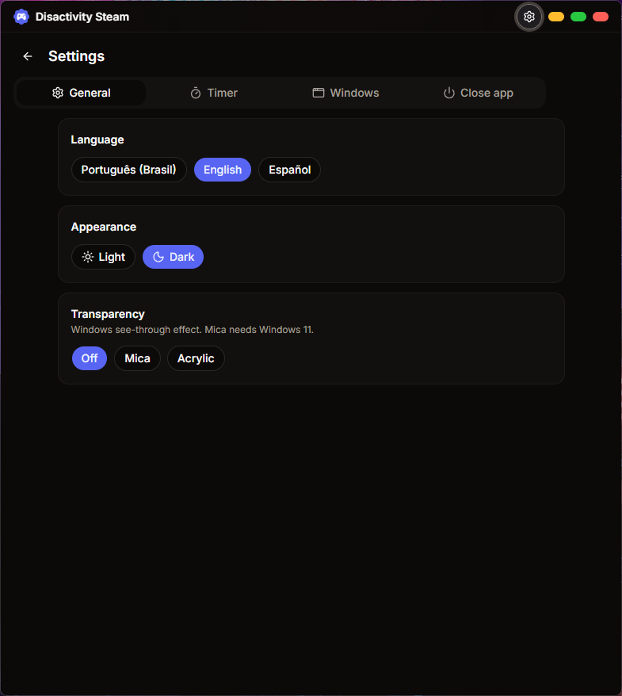
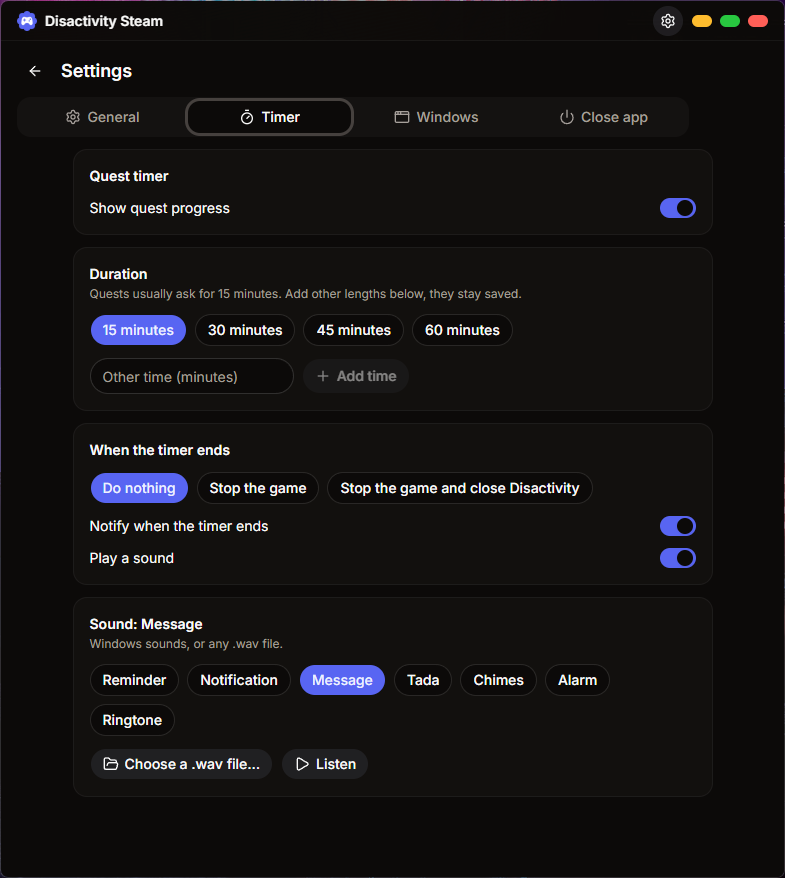

<p align="center">
  
</p>

<h1 align="center">Disactivity Steam</h1>

<p align="center">
  <strong>Discord Activity Simulator with Steam library support</strong><br>
  Simulate game activity on Discord, including the newer games that Discord only detects through Steam.
</p>

<p align="center">
  <a href="https://github.com/K1tsune12/disactivity-steam/releases/latest">
    
  </a>
  <a href="https://github.com/K1tsune12/disactivity-steam/blob/master/LICENSE">
    
  </a>
</p>

---

## 📖 About

Disactivity Steam is a fork of [Disactivity](https://github.com/holasoyender/disactivity) by [holasoyender](https://github.com/holasoyender). The interface and the way you use it are the same. The difference is that it can also run games that the original app hides because Discord has no executable registered for them.

Most games added to Discord since 2025 (EA Sports FC 27, Madden NFL 27, NHL 27, College Football 27 and thousands of others) come from Discord's API with an empty executable list. Discord detects those games through the Steam library instead of the executable name, so faking an `.exe` does nothing for them. This fork adds a Steam library mode that covers them.

<p align="center">
  
</p>

## ✨ Features

- 🎮 **Thousands of games**: browse and search Discord's whole detectable games list
- 🧩 **Steam library mode**: run games that have no executable on Discord's list, as long as they have a Steam ID
- 💾 **No download needed**: the game does not need to be installed, and it does not need to be in your Steam account
- ⭐ **Favorites**: favorite Steam games are prepared when the app opens, so one Discord restart covers all of them
- ⏱️ **Quest timer**: progress bar for quests of 15, 30, 45 or 60 minutes, or any length you add, with a notification and an optional action when it ends (stop the game, or stop it and close the app)
- 🔌 **Scheduled close**: close Disactivity after a number of minutes, independent from the games
- 🔎 **Steam games filter**: show only the games that run through the Steam library
- 🧹 **Clean taskbar**: optionally hide the fake game windows from the taskbar and Alt+Tab
- 📌 **System tray**: tray icon, with an option to close to the tray instead of quitting
- 🔄 **Automatic updates**: the installed app updates itself from this repository's releases
- 🪟 **Window memory**: size, position and maximized state are kept between launches
- 🗑️ **Automatic cleanup**: everything the app creates is removed when you stop a game or close the app, and leftovers from a crash are removed on the next launch
- 🌐 **Languages**: Portuguese (Brazil), English and Spanish, chosen in Settings or taken from the system

## 📸 Screenshots

| Game list | Steam library games |
|---|---|
|  |  |

| Settings: General | Settings: Timer |
|---|---|
|  |  |

## 📥 Download

Get the latest version from the [Releases](https://github.com/K1tsune12/disactivity-steam/releases/latest) page. There is an installer, which receives automatic updates, and a portable `.exe` that runs without installing.

## 🎮 How to use

1. Open Disactivity Steam
2. Search for a game and click **Run**
3. Discord shows that you are playing it
4. Click **Stop** when you are done

Games marked with a blue **Steam** tag run in Steam library mode. The first time Discord sees one of them it may need a restart, because Discord reads the Steam library only when it starts. When that happens the app shows a notice with a **Restart Discord** button. Steam can stay open or closed, it makes no difference.

Games that have both an executable and a Steam ID show a **Run via Steam library** option in the arrow menu next to the Run button.

The gear button in the title bar opens **Settings**, a full window screen with tabs:

| Option | What it does |
|---|---|
| Language | Portuguese (Brazil), English or Spanish |
| Quest timer | Progress bar of 15, 30, 45 or 60 minutes, or off. Other lengths can be added and stay saved in the list |
| Notify when the timer ends | Windows notification when the timer is reached |
| Play a sound | Sound when the timer ends: Reminder, Notification, Message, Tada, Chimes, Alarm, Ringtone (Windows sounds) or any .wav file |
| When the timer ends | Do nothing, stop the game, or stop the game and close Disactivity (only when no other game is running) |
| Close Disactivity | Closes the app after the minutes you choose, stopping every game. Only for the current session |
| Hide game windows from the taskbar | The fake windows still exist (Discord needs them) but stay out of the taskbar and Alt+Tab |
| Close to the system tray | The close button hides the app; quit from the tray icon |
| Theme | Light or dark, remembered between launches |
| Transparency | Windows Mica (Windows 11) or Acrylic effect, or off |

The filter button next to the search shows only Steam library games.

## 🚀 How it works

### Games with an executable (same as the original)

1. The app fetches the detectable games list from Discord's API
2. It creates a small process with the exact executable name Discord expects
3. Discord scans running processes, finds the name and shows the activity
4. The temporary files are deleted when you stop

### Steam library mode

Discord also maps processes to games through the Steam library. When a process runs from inside `steamapps/common/<game folder>`, Discord reads the game's `appmanifest` to find its Steam app ID and links it to the Discord game through the Steam ID listed in its API. The game also has to be listed in Steam's `libraryfolders.vdf`.

When you run one of these games, Disactivity Steam:

1. Checks whether the game is really installed in one of your Steam libraries. If it is, it uses that folder and does not touch any Steam file
2. If not, it writes an `appmanifest_<id>.acf` marked as installed (so Steam does not try to download anything), adds the app ID to `libraryfolders.vdf` and creates the game folder
3. Starts the fake process from `<game folder>/_disactivity/`
4. When you stop the game (or unfavorite it, or close the app), removes exactly what it created

What was created is also saved to `%APPDATA%\disactivity\disactivity_steam_sessions.json`, so if the app is killed or crashes, the next launch cleans it up. While games are running, the app checks every minute that its entries are still there and puts them back if Steam rewrote its files.

## 🔧 Building from source

### Requirements

- [Node.js](https://nodejs.org/) (npm) or [Bun](https://bun.sh/)
- [Rust](https://www.rust-lang.org/tools/install) (stable, MSVC toolchain)
- [Visual Studio Build Tools](https://visualstudio.microsoft.com/visual-cpp-build-tools/) with the "Desktop development with C++" workload

### Steps

```bash
git clone https://github.com/K1tsune12/disactivity-steam.git
cd disactivity-steam
npm install

# The fake game process is embedded in the app, so build it first
cd src-tauri/slave
cargo build --release
cd ../..

# Development
npm run tauri dev

# Production (portable exe in src-tauri/target/release, installer in src-tauri/target/release/bundle)
npm run tauri build
```

### Automatic builds

The [Build workflow](.github/workflows/build.yml) compiles the app on GitHub, so nothing needs to be installed to get a new version:

- every push builds the installer and the portable exe and keeps them as an artifact on the workflow run, for testing
- pushing a tag such as `v1.1.0` publishes them as a release, with the notes from `RELEASE_NOTES.md` and the `latest.json` used by the updater

The installer is signed for the updater with a key stored in the repository secrets `TAURI_SIGNING_PRIVATE_KEY` and `TAURI_SIGNING_PRIVATE_KEY_PASSWORD`. A fork of this project needs its own key (`npx tauri signer generate`) and its own `pubkey` and endpoint in `src-tauri/tauri.conf.json`.

## 📁 Project structure

```
disactivity-steam/
├── src/                    # Frontend (React + TypeScript)
│   ├── components/         # UI components
│   ├── i18n/locales/       # Translations
│   └── lib/                # Utilities
├── src-tauri/              # Backend (Rust + Tauri)
│   ├── src/                # Rust source, including Steam library mode
│   ├── slave/              # The fake game process
│   └── icons/              # Application icons
└── public/                 # Static assets
```

## 🔀 Changes from the original

- Steam library mode for games without executables (they were filtered out before)
- Favorite Steam games are prepared at startup to avoid one Discord restart per game
- **Restart Discord** button
- Automatic executable selection now prefers the game over its launcher (it picked the launcher for games like Baldur's Gate 3 and League of Legends)
- A failure loading Discord's non-games list no longer breaks the whole game list
- Window size and position are remembered
- Settings menu with language, quest timer, window and tray options
- Quest timer notification and automatic stop
- Option to hide the fake game windows from the taskbar
- System tray icon
- Steam games filter
- Automatic updates from this fork's releases
- Portuguese (Brazil) translation
- Steam is also found through the machine-wide install path when the user entry is missing


## 🛡️ Privacy and safety

- No data collection
- The only network requests go to Discord's public API (games list and icons)
- Steam files are only changed in Steam library mode, and only to add and later remove the entries described above

## ⚠️ Disclaimer

This project is not affiliated with Discord or Valve. Simulating game activity goes against Discord's Terms of Service, so use it at your own risk.

## 📄 License

MIT, see [LICENSE](LICENSE). Based on [Disactivity](https://github.com/holasoyender/disactivity), Copyright (c) 2026 holasoyender.

## 🤝 Credits

- [holasoyender](https://github.com/holasoyender), author of the original Disactivity
- [K1tsune12](https://github.com/K1tsune12), Steam library mode and the other changes in this fork
- [kevenemanuel773-tech](https://github.com/kevenemanuel773-tech/disactivitybetter), Portuguese translation and the settings menu this fork's version is based on
